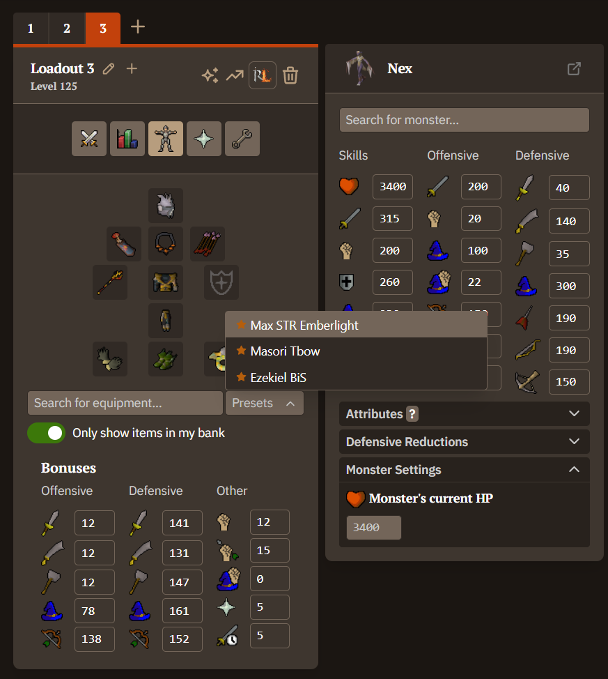
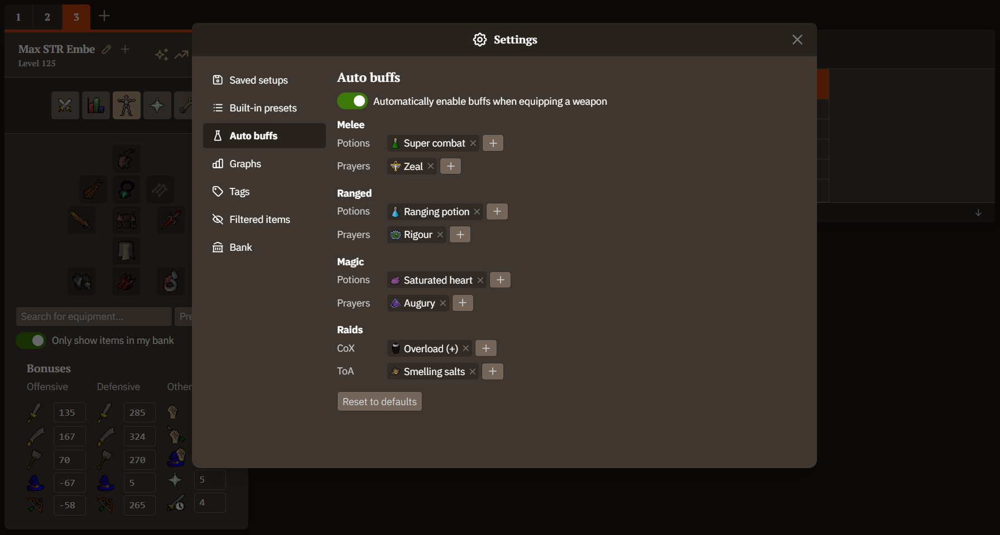
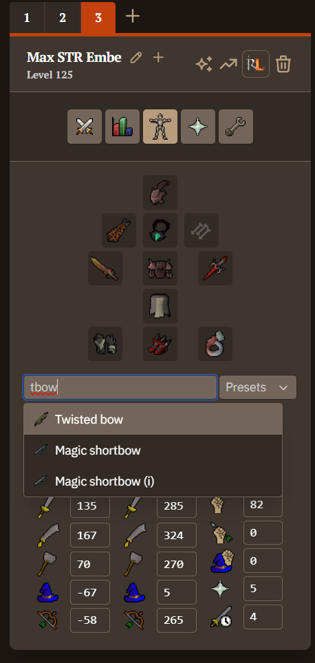
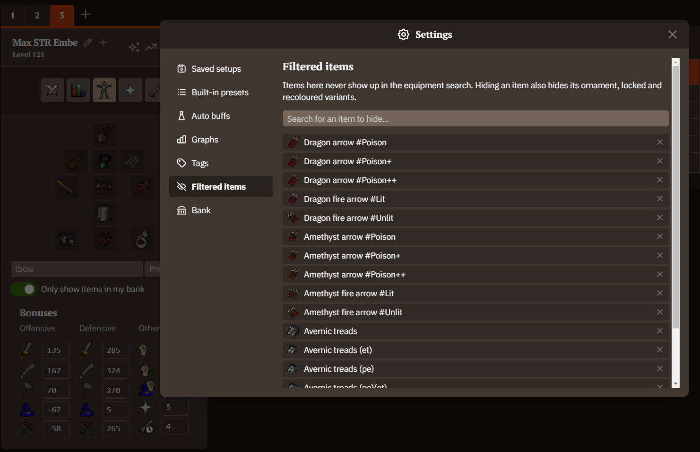
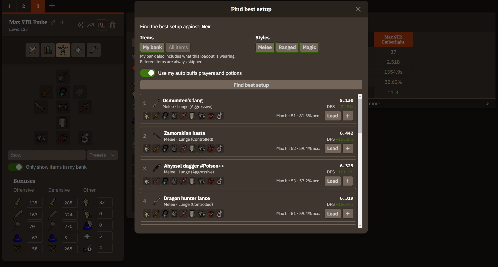
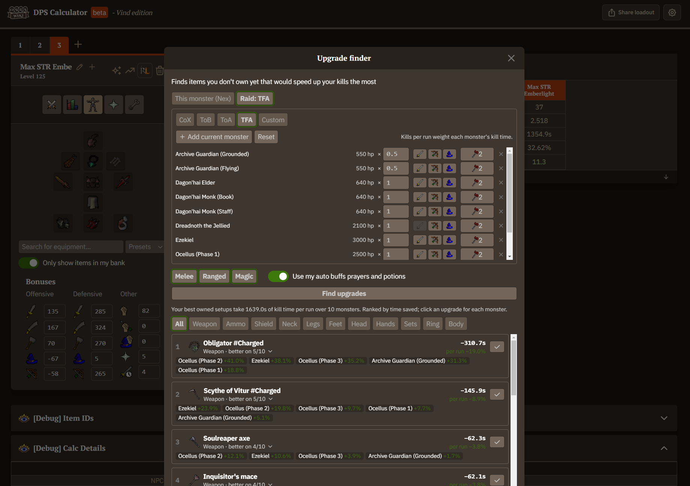

# OSRS Wiki DPS Calculator - Vind Edition

Expanded OSRS Wiki DPS calculator, sporting a ton of new features.

### Saved presets

Save your setups as presets, easily accessible under "Presets".

### Auto-buff

Automatically enables user-defined buffs when you set a new weapon, like enabling Rigour and Ranging potion when calcing a ranged weapon.

### User-defined tag searching

Lets you search items by user-defined tags, such as finding the Twisted bow by searching "tbow".

### Item search filter

Lets you remove items from the equipment search, such as ammo variants.

### Best setup finder

Inspired by Gearscape, lets you import your bank and find what your best setups are against the selected monster.

### Upgrade finder

Searches for items you don't own that would grant you the highest damage gain against the selected monster. Supports all raids. This is an experimental feature and there are bound to be bugs.

## Acknowledgements
* The original [OSRS Wiki DPS Calculator](https://tools.runescape.wiki/osrs-dps) ([source](https://github.com/weirdgloop/osrs-dps-calc)) by the OSRS Wiki and Weird Gloop, which this is built on
* Bitterkoekje's [spreadsheet](https://docs.google.com/spreadsheets/d/1wzy1VxNWEAAc0FQyDAdpiFggAfn5U6RGPp2CisAHZW8/edit?pli=1#gid=158500257) for a lot of initial math, formulas, and more
* Many [OSRS Wiki](https://oldschool.runescape.wiki) contributors for information on items, monsters, spells, and more
* ...and all of the [contributors](https://github.com/weirdgloop/osrs-dps-calc/graphs/contributors) to the original project!
